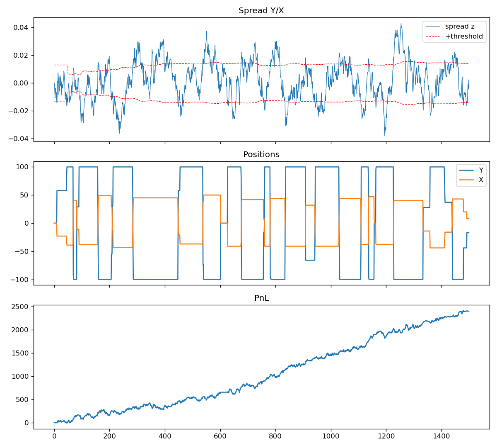

# Pairs Trading with Cointegration


A statistical-arbitrage strategy that trades the spread between two cointegrated stocks.
It started as a group assignment for the *Algorithms in Finance* course (MSc Banking & Finance,
Utrecht University, 2024), where it ran live on Optiver's Optibook training exchange.

This version has been rewritten as a standalone, tested Python package:

* **No dependency on Optibook.** The course exchange is private, so the repository ships a small
  simulated limit-order-book exchange with the same interface (order books, positions, PnL,
  immediate-or-cancel orders). The strategy runs unchanged against either one.
* **Bug fixes** from the original notebook (see [below](#changes-from-the-original-coursework)).
* **Unit tests** for the econometrics, the exchange and the strategy's risk limits.

## Method

**1. Pair selection: Engle-Granger two-step test**

$$\ln y_t = c + \gamma \ln x_t + z_t \qquad\qquad \Delta \ln y_t = \alpha\, z_{t-1} + \varepsilon_t$$

Every pair of stocks is regressed in both directions. A pair is tradable when the residual
$z_t$ is stationary (residual-based ADF test, MacKinnon critical values, 1% level).
$\alpha$ is the error-correction speed; the spread's half-life is $\ln 0.5 / \ln(1+\alpha)$.

**2. Executable spread signals**

Signals use the side of the book the strategy would actually trade at, so a signal is only taken
if it survives the bid/ask spread:

$$z_1 = \ln y^{bid} - c - \gamma \ln x^{ask} \qquad z_2 = \ln y^{ask} - c - \gamma \ln x^{bid}$$

* $z_1 > k\sigma$: Y is rich: **sell Y, buy X**
* $z_2 < -k\sigma$: Y is cheap: **buy Y, sell X**

$\sigma$ is a rolling standard deviation of the mid spread (500 observations), so the threshold
adapts to the current regime. $k$ = 0.5, 1 and 1.5 were compared in the report.

**3. Sizing and risk control**

* Hedge ratio in shares: $A = \gamma \, P_y / P_x$ (X shares per Y share).
* Volume is the minimum of the top-of-book depth on both legs and the remaining room under a
  ±100 position limit.
* The hedge leg is sized on the *filled* volume of the first leg.
* If the share ratio drifts more than 20% from $A$, the pair is flattened.
* Optional `exit_at_mean`: close when the spread crosses zero (the improvement proposed in the
  report's discussion), which trades smaller and more often.

## Quick start

```bash
git clone https://github.com/Amir-Shokat/pairs-trading-cointegration.git
cd pairs-trading-cointegration
pip install -e ".[dev,data]"
pytest                                    # 17 tests

python scripts/run_backtest.py            # synthetic cointegrated pair
python scripts/run_backtest.py --exit-at-mean
python scripts/run_backtest.py --yahoo KO PEP --start 2015-01-01   # real daily data
python scripts/screen_pairs.py my_prices.csv                       # screen a universe
```

Example output on the synthetic pair (fitted on the first half, traded on the second half):

```
Fitted Y on X: c=1.646 gamma=0.514 alpha=-0.0362 p=0.0000 half-life=18.8
Out-of-sample steps: 1500  trades: 137  final PnL: 2393.41
```



> Real stock pairs are rarely cointegrated over long daily samples: NVDA/CSCO from 2015 gives
> p = 0.87, and the script prints a warning in that case. The pairs used in the course
> (NVDA/CSCO, ING/SAN) were cointegrated within the Optibook simulation, not in real markets.

## Project layout

```
src/pairs_trading/
    cointegration.py   Engle-Granger estimation, test and pair screening
    strategy.py        PairsTrader: signals, thresholds, sizing, hedge checks
    exchange.py        Simulated order-book exchange (Optibook-compatible subset)
    simulation.py      Synthetic cointegrated / independent price paths
scripts/               Backtest and screening command-line tools
tests/                 pytest suite
```

## Changes from the original coursework

| Original notebook | Now |
|---|---|
| The threshold was `0` until 500 observations had accumulated, so the bot traded on any tiny positive spread at start-up | Uses the in-sample residual std until enough live history exists |
| The second leg was sent for the requested volume even if the first leg only partly filled | Hedge leg sized on the actual fill |
| A hedge-ratio breach flattened *every* instrument at extreme limit prices (0.10 / 100,000) | Only the affected pair is flattened, at the touch |
| Plain ADF p-value on estimated residuals (noted as an approximation in the course code) | MacKinnon residual-based p-values by default; the ADF version stays available |
| `pairs` was used before it was defined, with `c` and `gamma` re-estimated on every loop | Fits are computed once, out of sample, and passed in |
| Deprecated `params[0]` positional indexing | `params.iloc[0]` |

## Credits

The original was a five-person group project. The strategy design, the report and the first
implementation were joint work; this repository is my own rewrite and extension of it.
The `estimate_long_run_short_run_relationships` / Engle-Granger helpers follow the template
provided in the course.

## License

MIT
